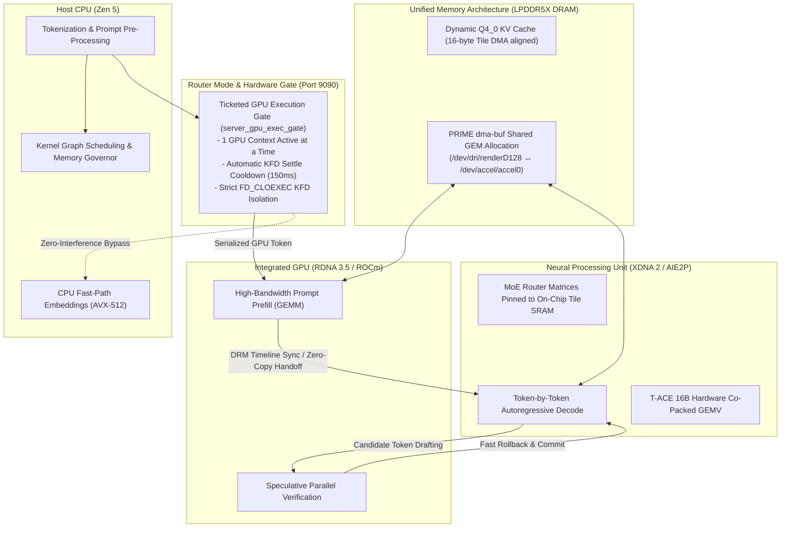

# llama-apu

<div align="center">

### Heterogeneous APU (CPU + iGPU + XDNA 2 NPU) LLM Inference Engine for AMD Ryzen AI

[](LICENSE)
[-FF3800.svg)](https://www.amd.com)
[-brightgreen.svg)]()
[-purple.svg)]()

</div>

---

## ⚡ Overview

**llama-apu** is an open-source, high-performance heterogeneous inference engine specifically co-designed for AMD Ryzen AI Accelerated Processing Units (APUs) featuring **Zen 5 CPU cores**, **RDNA 3.5 integrated graphics (gfx1150 / gfx1151)**, and the **AMD XDNA 2 Neural Processing Unit (AIE2P vector PE array)**.

By exploiting Unified Memory Architecture (UMA) via kernel-level **PRIME dma-buf buffer sharing**, **DRM timeline sync objects**, and **Router-level GPU Execution Serialization**, `llama-apu` orchestrates multi-model inference across on-die execution units simultaneously with **0 host memory copies** and **zero GPU aperture hangs**, delivering rock-solid server-class LLM execution on consumer laptop and mini-PC APU silicon.

---

## 🏗️ Heterogeneous APU Architecture



---

## 🚀 Key Features

### 1. Router GPU Execution Gate & CPU Fast-Path (`v0.11.0`)
- **MES Queue & Aperture Collision Immunity:** Fixes fatal kernel driver lockups (`HSA_STATUS_ERROR_MEMORY_APERTURE_VIOLATION` -> MES `REMOVE_QUEUE` -> `MODE2` GPU reset) on AMD Strix Point APUs (`gfx1150`) running with `amdgpu.cwsr_enable=0`.
- **Ticket-Based FIFO GPU Gate:** In multi-model router mode, keeps up to `--models-max N` models resident in memory simultaneously while serializing active GPU compute passes (`server_gpu_exec_gate`).
- **Zero-Latency CPU Fast-Path:** Non-GPU models (`n-gpu-layers = 0`, e.g. `nomic-embed-text-v1.5`) bypass the GPU lock entirely and execute in parallel on Zen 5 AVX-512 without queuing behind long GPU generations.
- **Strict KFD Descriptor Isolation:** Router automatically injects `HIP_VISIBLE_DEVICES=-1` and `ROCR_VISIBLE_DEVICES=-1` and enforces `FD_CLOEXEC` on `/dev/kfd` and `/dev/dri`, eliminating stray GPU queue handle inheritance.
- **KFD Settle Cooldown (150ms):** Automatically dampens hardware queue deregistration upon client disconnects or child process teardown.

### 2. Sarathi-Serve Stall-Free Scheduling
- Iteration-level hybrid micro-batching under a hard token budget $\tau$ with four-tier priority (ongoing decodes → preempted-slot recovery → in-flight prefill chunks → new-request admission).
- Bounds prefill chunks to minimize Time-Between-Tokens (TBT) outliers during concurrent background prompt ingestion.

### 3. Zero-Copy Cross-Device Memory Bridge
- Maps physical AMDGPU GEM memory (`/dev/dri/renderD128`) directly into the AMDXDNA NPU context (`/dev/accel/accel0`) via PRIME dma-buf export and import.
- Enforces strict **16-byte Tile DMA beat boundaries** and **64-byte host CPU cache line alignment**.
- Eliminates host memory copying entirely: **0 host `memcpy` operations** between prefill, decode, and speculative verification phases.

### 4. Dynamic Q4_0 KV Cache Quantization
- Real-time FP16-to-Q4_0 KV cache compression during generation.
- Reduces KV cache UMA DRAM footprint by **71.9% (3.56× memory savings)**, enabling 32k+ context windows on compact mobile memory envelopes.

### 5. Native TQ2_0 Quantization (2.0625 bpw) & T-ACE 16B Hardware Lowering
- Native C++ engine support for `GGML_TYPE_TQ2_0` (2.0625 bits per weight).
- **RoPE-Compliant Per-Head QuaRot:** Randomized Fast Walsh-Hadamard Transforms (FWHT) applied per attention head to eliminate activation outliers while commuting with 2D rotary position embeddings.
- **T-ACE 16-Byte Tile Lowering:** Contiguous 16-byte beats for native vector execution on AIE2P processing tiles.

### 6. MoE Router Isolation & On-Chip SRAM Pinning
- Automatically detects Mixture-of-Experts (MoE) architectures and isolates multi-layer router gating matrices ($W_{\text{gate}}$).
- Directly pins router matrices into ultra-low-latency on-chip AIE2P Tile SRAM with configurable budget limits (`--router-sram {auto,on,off}`).

### 7. DRM Syncobj Timeline Speculative Decoding
- Inter-accelerator speculative decoding coordinated via Linux DRM timeline sync objects.
- Signals candidate token batch verification between GPU and NPU with **sub-10 microsecond latency**.

---

## 🛠️ Quickstart

### Diagnostic Verification

```bash
# Run system diagnostic
llama-apu-cli apu-doctor
```

Expected output:
```text
[*] Checking AMD XDNA NPU Accelerator...
    [PASS] Device node /dev/accel/accel0 is accessible (read/write)
    [PASS] Kernel driver 'amdxdna' is loaded
[*] Checking AMD GPU DRM Render Node (GEM / PRIME dma-buf)...
    [PASS] Device node /dev/dri/renderD128 is accessible (read/write)
[*] Checking AMD KFD Compute Interface (ROCm / HIP)...
    [PASS] Device node /dev/kfd is accessible (read/write)
[*] Checking AMD XRT Runtime Environment...
    [PASS] AMD XRT core library 'libxrt_coreutil.so.2' dynamically loaded
[*] Checking Memory Subsystem & UMA Headroom...
    [PASS] System RAM: 59.5 GB Total, 45.7 GB Available
===================================================================
  DOCTOR VERDICT: ALL SYSTEMS HEALTHY (Physical APU ready)
===================================================================
```

### Installation & Docker Deployment

```bash
# Clone the repository
git clone https://github.com/fencerJP/llama-apu.git
cd llama-apu

# Run with Docker Compose
cd /opt/docker/llama-apu
docker compose up -d --build
```

### End-to-End Test Suite

Run the full realistic verification suite (streaming high-token prompts, concurrent embedding bursts, GPU contention, and kernel audits):

```bash
python3 scripts/test_router_gpu_gate_e2e.py
```

---

## 📚 Acknowledgements & References

`llama-apu` builds on the pioneering contributions of `ggml-org/llama.cpp`, `atomic-gern/guanaco`, `fastflowLM`, and academic breakthroughs in heterogeneous computing, hardware queue serialization, and low-bit quantization.

Please see **[ACKNOWLEDGEMENTS.md](ACKNOWLEDGEMENTS.md)** for a full list of research publications, authors, and open-source foundations.

---

## 📄 License

This software is released under the **MIT License** and **Apache License 2.0**. See [LICENSE](LICENSE) for details.
