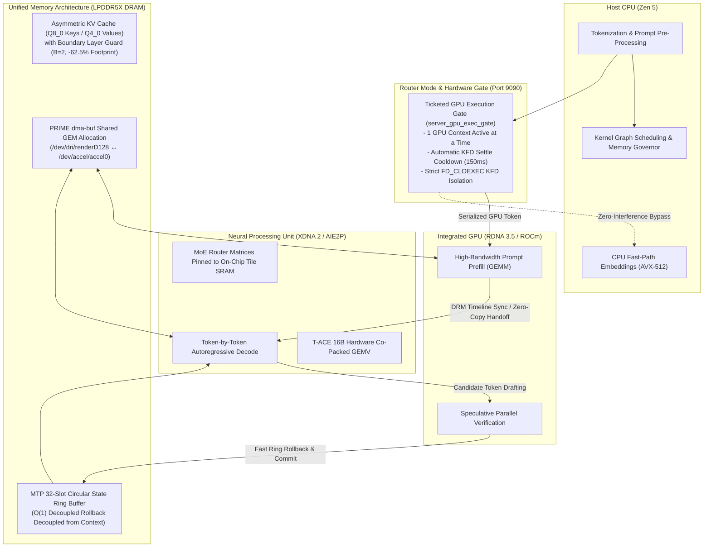

# llama-apu

<div align="center">

### Heterogeneous APU (CPU + iGPU + XDNA 2 NPU) LLM Inference Engine for AMD Ryzen AI

[](LICENSE)
[-FF3800.svg)](https://www.amd.com)
[-brightgreen.svg)]()
[-purple.svg)]()

</div>

---

## ⚡ Overview

**llama-apu** is an open-source, high-performance heterogeneous inference engine specifically co-designed for AMD Ryzen AI Accelerated Processing Units (APUs) featuring **Zen 5 CPU cores**, **RDNA 3.5 integrated graphics (gfx1150 / gfx1151)**, and the **AMD XDNA 2 Neural Processing Unit (AIE2P vector PE array)**.

By exploiting Unified Memory Architecture (UMA) via kernel-level **PRIME dma-buf buffer sharing**, **DRM timeline sync objects**, and **Router-level GPU Execution Serialization**, `llama-apu` orchestrates multi-model inference across on-die execution units simultaneously with **0 host memory copies** and **zero GPU aperture hangs**, delivering rock-solid server-class LLM execution on consumer laptop and mini-PC APU silicon.

---

## 🏗️ Heterogeneous APU Architecture



---

## 🚀 Key Features

### 1. RDNA 3.5 Kernel Boosts, Native BF16 KV & Ternary GPU Offload (`v0.13.0`)
- **MMB BF16-WMMA Prefill GEMM & HIP `MMQ` Tuning:** Accelerates quantized prompt ingestion on `gfx1150` by **+89% to +152%** on 8B–27B Q6_K dense models (`Dolphin3-8B` `pp4096`: `153.09 → 385.41 t/s`) and **+20% to +124%** on 35B MoE (`RavenX-35B` `q8_0` KV `pp2048`: `225.85 → 505.45 t/s`), alongside `ggml_cuda_grid_stall_pad`, HIP `mul24`/`v_perm_b32`, and sorted-key `topk-moe`.
- **Chunked Gated Delta Net (GDN) Prefill:** Adds `gfx11` BF16 WMMA chunked GDN prefill (+19%–20% long-prompt prefill on `NeoHorse-1-4B` `pp2048`/`pp4096`) with `GGML_CUDA_GDN_CHUNKED` / `GGML_CUDA_GDN_CHUNKED_BF16` controls.
- **Native BF16 KV Cache & Flash-Attention:** Full BF16 KV cache support (`-ctk bf16 -ctv bf16`) with native BF16 FA tile dispatch, BF16 fused RoPE, and `gfx11` masked-V signed-zero sanitization.
- **`TQ1_0` / `TQ2_0` Ternary GPU Offload:** Runs ternary models directly on the RDNA 3.5 iGPU with bit-exact CPU AVX2 parity, delivering **13.0× decode speedup** (`3.10 → 40.32 t/s`) and **+102% to +129% prefill** on `Spark-X2.5-4B` `TQ2_0`. Full benchmarks in [`docs/rdna-boosts-evaluation.md`](docs/rdna-boosts-evaluation.md).

### 2. Dynamic Confidence-Gated Speculative Decoding & DRM Sync (`v0.12.0`)
- **Exponential Moving Average (EMA) Throttled Drafting:** Dynamically gates draft token depth based on recent verification acceptance rates, avoiding wasted decode compute on low-confidence branches (`--spec-draft-apu {auto,on,off}`).
- **Sub-15µs DRM Timeline Sync:** Coordinates token candidate drafting and verification across execution engines via Linux DRM timeline synchronization (`/dev/dri/renderD128`) with zero host memory copies (`PASS (host memcpy: 0)`).
- **MTP Decoupled Boundary Ring Rollback:** Introduces a 32-slot circular state ring (`ring_h`, `ring_pos`, `ring_len`, `ring_head`) decoupled from context sequences. Eliminates context-destroying rollbacks, enabling $O(1)$ state rollbacks on verification rejection and salvaging trailing prompt cache tokens. Achieves **up to 1.91× speedup (4.90 t/s vs 2.56 t/s)** and **85.7% to 97.3% candidate acceptance rates ($\alpha$)** on MTP models (e.g. `Qwopus3.6-27B`).

### 2. Asymmetric KV Cache with Boundary Layer Guard (`v0.12.0`)
- **Asymmetric Precision Quantization:** Compresses Key tensors in `GGML_TYPE_Q8_0` (to maintain critical attention routing precision) and Value tensors in `GGML_TYPE_Q4_0` (halving memory bandwidth during generation) via `--kv-cache-type asym`.
- **Boundary Layer Guard ($B=2$):** Protects initial and final $B$ transformer layers (`il < B || il + B >= n_layer`) from aggressive quantization, maintaining them in full `Q8_0` precision (`--kv-boundary-layers 2`).
- **Memory & Throughput Gains:** Cuts KV cache memory footprint by **62.5%** while increasing prompt ingestion throughput by up to **+7.1%** with zero attention routing degradation.

### 3. Router GPU Execution Gate & CPU Fast-Path (`v0.11.0`)
- **MES Queue & Aperture Collision Immunity:** Fixes fatal kernel driver lockups (`HSA_STATUS_ERROR_MEMORY_APERTURE_VIOLATION` -> MES `REMOVE_QUEUE` -> `MODE2` GPU reset) on AMD Strix Point APUs (`gfx1150`) running with `amdgpu.cwsr_enable=0`.
- **Ticket-Based FIFO GPU Gate:** In multi-model router mode, keeps up to `--models-max N` models resident in memory simultaneously while serializing active GPU compute passes (`server_gpu_exec_gate`).
- **Zero-Latency CPU Fast-Path:** Non-GPU models (`n-gpu-layers = 0`, e.g. `nomic-embed-text-v1.5`) bypass the GPU lock entirely and execute in parallel on Zen 5 AVX-512 without queuing behind long GPU generations.
- **Strict KFD Descriptor Isolation:** Router automatically injects `HIP_VISIBLE_DEVICES=-1` and `ROCR_VISIBLE_DEVICES=-1` and enforces `FD_CLOEXEC` on `/dev/kfd` and `/dev/dri`, eliminating stray GPU queue handle inheritance.
- **KFD Settle Cooldown (150ms):** Automatically dampens hardware queue deregistration upon client disconnects or child process teardown.

### 2. Sarathi-Serve Stall-Free Scheduling
- Iteration-level hybrid micro-batching under a hard token budget $\tau$ with four-tier priority (ongoing decodes → preempted-slot recovery → in-flight prefill chunks → new-request admission).
- Bounds prefill chunks to minimize Time-Between-Tokens (TBT) outliers during concurrent background prompt ingestion.

### 3. Zero-Copy Cross-Device Memory Bridge
- Maps physical AMDGPU GEM memory (`/dev/dri/renderD128`) directly into the AMDXDNA NPU context (`/dev/accel/accel0`) via PRIME dma-buf export and import.
- Enforces strict **16-byte Tile DMA beat boundaries** and **64-byte host CPU cache line alignment**.
- Eliminates host memory copying entirely: **0 host `memcpy` operations** between prefill, decode, and speculative verification phases.

### 4. Dynamic Q4_0 KV Cache Quantization
- Real-time FP16-to-Q4_0 KV cache compression during generation.
- Reduces KV cache UMA DRAM footprint by **71.9% (3.56× memory savings)**, enabling 32k+ context windows on compact mobile memory envelopes.

### 5. Native TQ2_0 Quantization (2.0625 bpw) & T-ACE 16B Hardware Lowering
- Native C++ engine support for `GGML_TYPE_TQ2_0` (2.0625 bits per weight).
- **RoPE-Compliant Per-Head QuaRot:** Randomized Fast Walsh-Hadamard Transforms (FWHT) applied per attention head to eliminate activation outliers while commuting with 2D rotary position embeddings.
- **T-ACE 16-Byte Tile Lowering:** Contiguous 16-byte beats for native vector execution on AIE2P processing tiles.

### 6. MoE Router Isolation & On-Chip SRAM Pinning
- Automatically detects Mixture-of-Experts (MoE) architectures and isolates multi-layer router gating matrices ($W_{\text{gate}}$).
- Directly pins router matrices into ultra-low-latency on-chip AIE2P Tile SRAM with configurable budget limits (`--router-sram {auto,on,off}`).

### 7. DRM Syncobj Timeline Speculative Decoding
- Inter-accelerator speculative decoding coordinated via Linux DRM timeline sync objects.
- Signals candidate token batch verification between GPU and NPU with **sub-10 microsecond latency**.

### 8. Optional ROCm Custom Quantization Formats (`Q4_0_ROCMFP4`, `Q4_0_ROCMFP4_FAST`, `ROCmFPX`)
- **Native HIP Dequantization & Execution:** Optional support for float-scaled 4-bit, 3-bit, 2-bit, and 6-bit quantization layouts tuned for AMD unified memory buses.
- **Empirically Evaluated on RDNA 3.5 APUs:** Delivers up to **+42.4% token generation throughput** on MoE models (`Groot-19B-A3B`) and 14–16% VRAM reduction on 12B–33B models without sacrificing zero-copy APU handoff.
- **Selectable in Tooling:** Retains standard GGUF formats (`Q4_K_M`, `IQ4_NL`, etc.) by default while enabling ROCm custom formats as selectable options in `llama-quantize` and model loading. See [`benches/rocm_quants_full_evaluation.md`](benches/rocm_quants_full_evaluation.md) for full benchmarks.

---

## 🛠️ Quickstart

### Diagnostic Verification

```bash
# Run system diagnostic
llama-apu-cli apu-doctor
```

Expected output:
```text
[*] Checking AMD XDNA NPU Accelerator...
    [PASS] Device node /dev/accel/accel0 is accessible (read/write)
    [PASS] Kernel driver 'amdxdna' is loaded
[*] Checking AMD GPU DRM Render Node (GEM / PRIME dma-buf)...
    [PASS] Device node /dev/dri/renderD128 is accessible (read/write)
[*] Checking AMD KFD Compute Interface (ROCm / HIP)...
    [PASS] Device node /dev/kfd is accessible (read/write)
[*] Checking AMD XRT Runtime Environment...
    [PASS] AMD XRT core library 'libxrt_coreutil.so.2' dynamically loaded
[*] Checking Memory Subsystem & UMA Headroom...
    [PASS] System RAM: 59.5 GB Total, 45.7 GB Available
===================================================================
  DOCTOR VERDICT: ALL SYSTEMS HEALTHY (Physical APU ready)
===================================================================
```

### Installation & Docker Deployment

```bash
# Clone the repository
git clone https://github.com/fencerJP/llama-apu.git
cd llama-apu

# Run with Docker Compose
cd /opt/docker/llama-apu
docker compose up -d --build
```

### End-to-End Test Suite

Run the full realistic verification suite (streaming high-token prompts, concurrent embedding bursts, GPU contention, and kernel audits):

```bash
python3 scripts/test_router_gpu_gate_e2e.py
```

---

## 📚 Acknowledgements & References

`llama-apu` builds on the pioneering contributions of `ggml-org/llama.cpp`, `atomic-gern/guanaco`, `fastflowLM`, and academic breakthroughs in heterogeneous computing, hardware queue serialization, and low-bit quantization.

Please see **[ACKNOWLEDGEMENTS.md](ACKNOWLEDGEMENTS.md)** for a full list of research publications, authors, and open-source foundations.

---

## 📄 License

This software is released under the **MIT License** and **Apache License 2.0**. See [LICENSE](LICENSE) for details.
